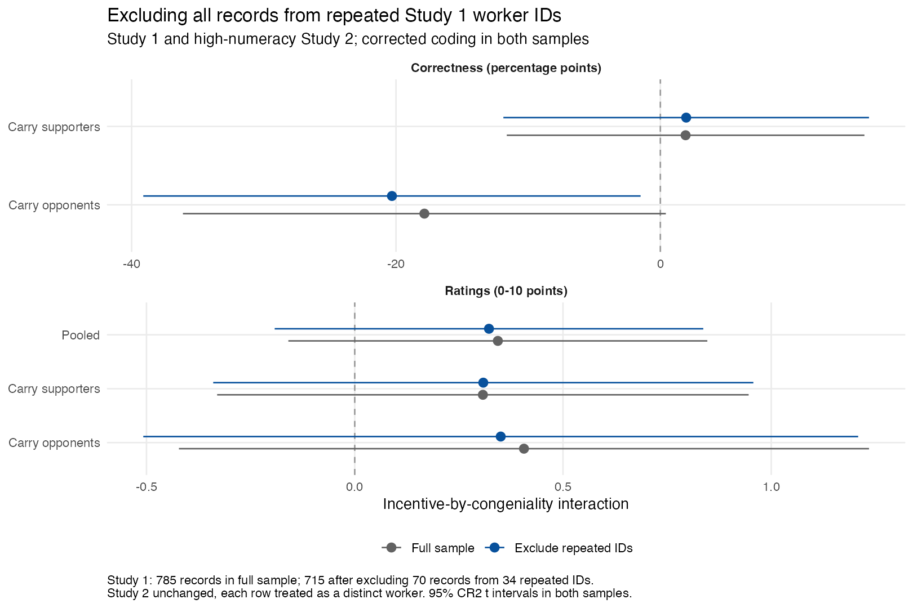

# Reproduced results and audit comparisons

Generated by `make analysis`. See [audit.md](audit.md) for interpretation, repairs, and limits.

Study 2's recovered minimum-wage correctness is 87.12% (n=947), reproducing the paper's 87%.
The original responses resolve the discrepancy: Dataverse V1 scores 524 correct; reconstruction scores 825.
The original release remains unchanged. See [source recovery](source_recovery.md) for linkage and scoring.

## Main contrasts

Primary t inference uses worker-cluster CR2 for Study 1 samples and HC2 otherwise. Effects are percentage points.
Unweighted sample estimates use reconstructed responses and corrected numeracy/party coding.

|Exhibit  |Group            |Contrast              |Estimate [95% CI], pp |Two-sided p |    N|
|:--------|:----------------|:---------------------|:---------------------|:-----------|----:|
|figure_2 |Carry opponents  |interaction           |-17.85 [-36.12, 0.41] |0.0554      |  456|
|figure_2 |Carry supporters |interaction           |1.91 [-11.62, 15.44]  |0.7819      |  835|
|figure_3 |Carry opponents  |incentive_uncongenial |6.93 [-1.81, 15.68]   |0.1200      |  416|
|figure_3 |Carry supporters |incentive_uncongenial |-0.31 [-7.66, 7.03]   |0.9330      |  639|
|figure_4 |Wage opponents   |interaction           |-10.99 [-25.54, 3.55] |0.1381      |  498|
|figure_4 |Wage supporters  |interaction           |3.97 [-4.01, 11.96]   |0.3293      | 1394|

## Minimum-wage publication comparisons

Historical coding with repaired wage fields; separate from the corrected primary estimates.

|Exhibit     |Group           | Congenial| Incentive| Published (%)| Reproduced (%)| Difference (pp)|
|:-----------|:---------------|---------:|---------:|-------------:|--------------:|---------------:|
|figure_4    |Wage opponents  |         0|         0|          62.0|          62.04|            0.04|
|figure_4    |Wage opponents  |         1|         0|          89.3|          89.34|            0.04|
|figure_4    |Wage opponents  |         0|         1|          70.4|          70.40|            0.00|
|figure_4    |Wage opponents  |         1|         1|          86.7|          86.71|            0.01|
|figure_4    |Wage supporters |         0|         0|          87.0|          86.98|           -0.02|
|figure_4    |Wage supporters |         1|         0|          76.2|          76.24|            0.04|
|figure_4    |Wage supporters |         0|         1|          86.3|          86.34|            0.04|
|figure_4    |Wage supporters |         1|         1|          79.6|          79.57|           -0.03|
|figure_si_7 |Wage supporters |         0|         0|          90.2|          90.23|            0.03|
|figure_si_7 |Wage supporters |         1|         0|          83.9|          83.85|           -0.05|
|figure_si_7 |Wage supporters |         0|         1|          89.7|          89.67|           -0.03|
|figure_si_7 |Wage supporters |         1|         1|          87.4|          87.42|            0.02|

## Do incentives change the congeniality gap in ratings?

Direct interactions compare the two effects; separate significance tests cannot answer this question.

|Group            |Rating interaction [95% CI] |Two-sided p |    N|
|:----------------|:---------------------------|:-----------|----:|
|Carry opponents  |0.41 [-0.42, 1.23]          |0.3355      |  453|
|Carry supporters |0.31 [-0.33, 0.95]          |0.3440      |  830|
|Pooled           |0.34 [-0.16, 0.85]          |0.1804      | 1283|

## Excluding all records from repeated Study 1 workers

The exclusion removes all 70 records from the 34 worker IDs repeated within the 785-record released Study 1 sample.
It leaves 715 Study 1 records. Identification precedes policy-position and outcome restrictions.
Study 2 is unchanged and each row is assumed to be a distinct worker.
Both samples use corrected coding and CR2 t inference, isolating the sample change.

|Outcome                         |Group            |Sample               |Interaction [95% CI]   |Two-sided p |    N|
|:-------------------------------|:----------------|:--------------------|:----------------------|:-----------|----:|
|Correctness (percentage points) |Carry opponents  |Full                 |-17.85 [-36.12, 0.41]  |0.0554      |  456|
|Correctness (percentage points) |Carry opponents  |Exclude repeated IDs |-20.31 [-39.12, -1.49] |0.0344      |  437|
|Correctness (percentage points) |Carry supporters |Full                 |1.91 [-11.62, 15.44]   |0.7819      |  835|
|Correctness (percentage points) |Carry supporters |Exclude repeated IDs |1.95 [-11.88, 15.78]   |0.7816      |  796|
|Ratings (0-10 points)           |Carry opponents  |Full                 |0.41 [-0.42, 1.23]     |0.3355      |  453|
|Ratings (0-10 points)           |Carry opponents  |Exclude repeated IDs |0.35 [-0.51, 1.21]     |0.4225      |  435|
|Ratings (0-10 points)           |Carry supporters |Full                 |0.31 [-0.33, 0.95]     |0.3440      |  830|
|Ratings (0-10 points)           |Carry supporters |Exclude repeated IDs |0.31 [-0.34, 0.96]     |0.3504      |  793|
|Ratings (0-10 points)           |Pooled           |Full                 |0.34 [-0.16, 0.85]     |0.1804      | 1283|
|Ratings (0-10 points)           |Pooled           |Exclude repeated IDs |0.32 [-0.19, 0.84]     |0.2193      | 1228|

Complete cells and contrasts, including Study 1 alone and ideological worldview, are in
`tabs/worker_exclusion_accuracy_cells.csv`, `tabs/worker_exclusion_accuracy_contrasts.csv`,
`tabs/worker_exclusion_rating_cells.csv`, and `tabs/worker_exclusion_rating_contrasts.csv`.
Study 2/3-only results are unaffected. All raw records remain available.

## Figure 5 standard-error repair

The archived selector recycles incentive labels over respondents. The correction uses one actual treatment cell.
Estimates do not change. These SEs isolate the repair; modern figures additionally use 95% t intervals.

|Group            |Condition    | Estimate| Archived SE| Correct SE|
|:----------------|:------------|--------:|-----------:|----------:|
|Carry supporters |no_incentive |   0.0988|    0.233436|   0.228622|
|Carry supporters |incentive    |   0.4065|    0.236267|   0.228625|
|Carry opponents  |no_incentive |   0.0471|    0.294055|   0.290969|
|Carry opponents  |incentive    |   0.4413|    0.314942|   0.312761|

## Machine-readable diagnostics

Full-precision estimates, denominators, model rank, missingness, assignments, specification checks and influence
diagnostics are in [tabs/](../tabs/). Original code execution logs are generated in `data/build/`.
